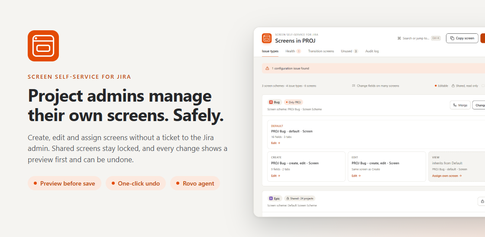
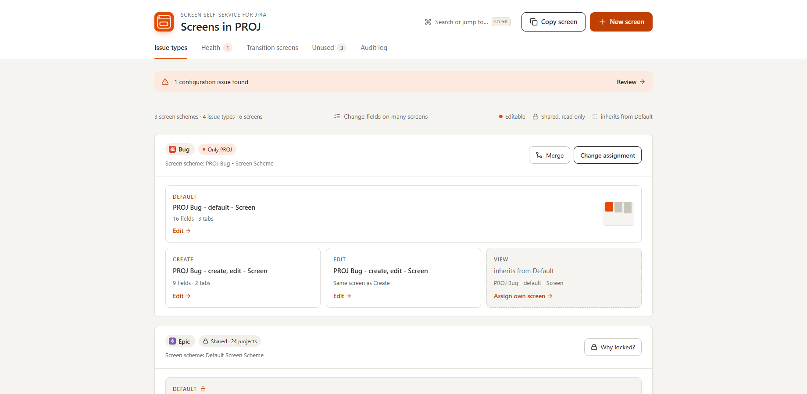
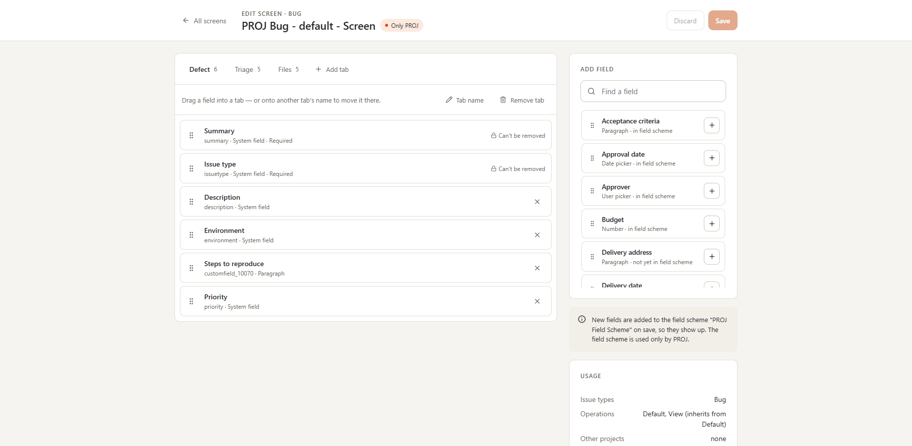
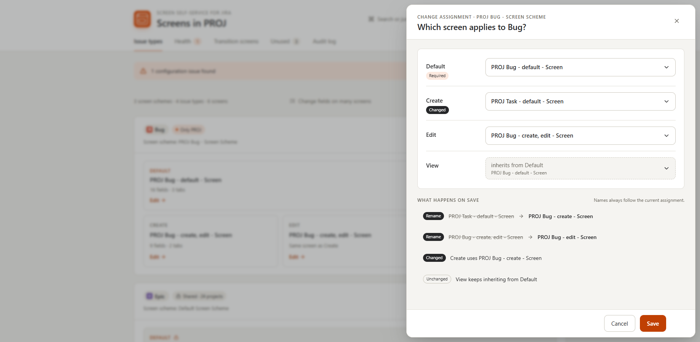
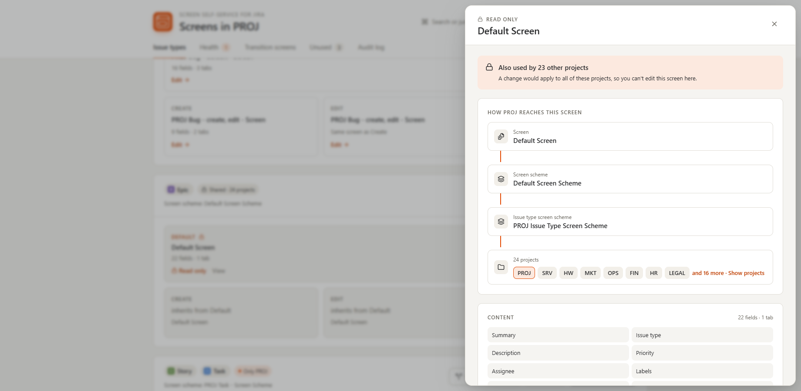
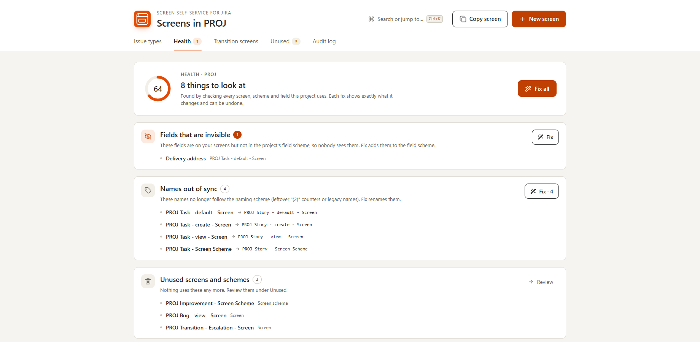
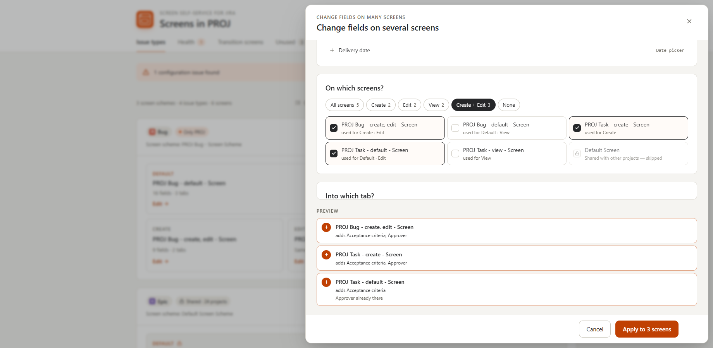
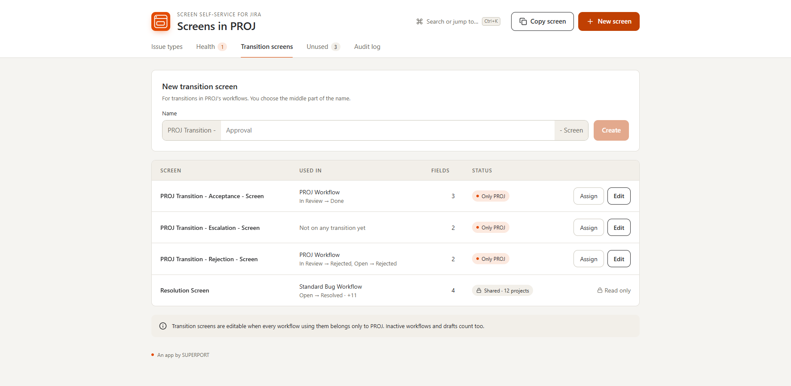
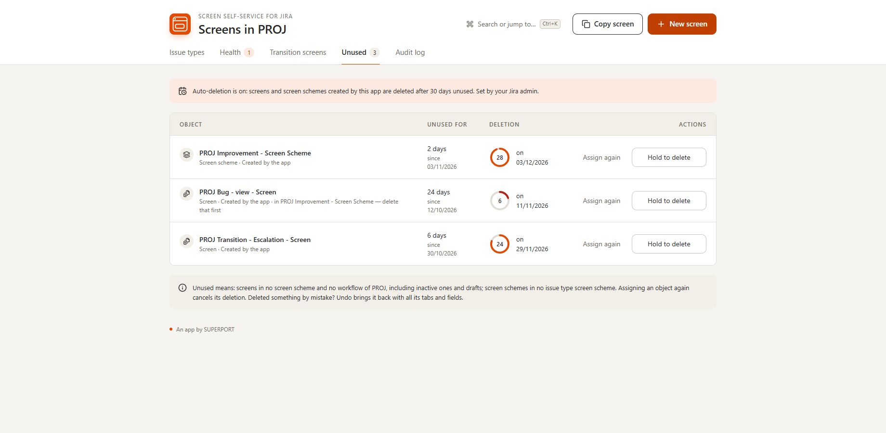

<div align="center">


# Screen Self-Service for Jira

**Project admins manage their own Jira screens. Safely, with a preview first, and always undoable.**

[](https://go.atlassian.com/runs-on-atlassian)
[](https://developer.atlassian.com/platform/forge/)
[](#screen-assistant-rovo)
[](#quality-and-verification)
[](https://superapps.statuspage.io/)

[Documentation](docs/DOCUMENTATION.md) · [Data security & privacy](docs/DATA_SECURITY_PRIVACY.md) · [EULA & privacy policy](https://www.superport.digital/en/apps/eula) · [Status](https://superapps.statuspage.io/) · [SUPERPORT](https://www.superport.digital/en/work?filter=weitere-branchen)



</div>

---

## Why

In company-managed Jira projects, only Jira admins can change screens. A project admin who needs one extra field on the create screen
files a ticket and waits, and the Jira admin spends time on small requests. Most of those changes only affect one project, but Jira can't
tell a safe change from a risky one, because screens and schemes are often shared between projects.

**Screen Self-Service for Jira can tell.** Project admins change everything that belongs to their project alone. Anything shared stays locked,
with an explanation. Every change is previewed in plain language, written to an audit log, and can be undone.

## Features

| | |
|---|---|
|  | **Overview of every issue type.** Default, Create, Edit and View screens at a glance, with which ones are editable, shared or inherited. Hover a screen to see everywhere it's used. |
|  | **Drag-and-drop screen editor.** Reorder fields, move them between tabs, add and rename tabs. Fields missing from the project's field scheme are added automatically, so they actually show up. |
|  | **Preview before every save.** Change which screen an issue type uses and see exactly what happens: assignments, renames, new objects. What you see is what runs. |
|  | **Shared means locked, with the reason.** See how your project reaches a shared screen and which projects share it, and copy it instead. |
|  | **Health check with one-click fixes.** Create screens without Summary, fields hidden by the field scheme, empty transition screens, out-of-date names, empty tabs and leftovers. |
|  | **Change fields on many screens at once,** with presets (Create + Edit, …) and a per-screen preview. Shared screens are skipped automatically. |
|  | **Transition screens.** Create a screen and switch it on per workflow transition, for workflows only your project uses. |
|  | **Clean-up.** Unused screens and schemes with a deletion countdown. Only objects the app created can be deleted, and every deletion can be undone. |

Also: split an issue type off a shared screen scheme or merge issue types, copy any screen on the site as a template,
Ctrl+K / ⌘K command palette, Undo with Ctrl+Z / ⌘Z, full audit log, English and German, light and dark theme, reduced-motion aware.

### Screen Assistant (Rovo)

The app includes a **Rovo agent** with five actions: *list project screens*, *explain a screen*, *find unused screens*, and
*add* / *remove a field* (Rovo asks for confirmation before any change). The agent follows exactly the same permission and safety
rules as the app.

## Built for safety

The app holds Jira admin scopes, so it must never do more than the *person using it* is allowed to do.

1. **Identity comes only from Forge's signed context.** User and project are never taken from the request payload.
2. **Every request re-checks real Jira permissions** (`POST /rest/api/3/permissions/check`): *Administer Projects* for the project page,
   *Administer Jira* for configuration.
3. **The client sends intents, never steps.** The backend validates the intent, loads **fresh** Jira state, rebuilds the plan with the shared
   rules and checks that every object a step touches belongs to the project alone, right before it writes.
4. **Fails closed.** If a site-wide usage scan fails or would be truncated, nothing is written.
5. **Undo only when safe.** Undo runs only if Jira still looks exactly like right after the change, and deletions are restored from a snapshot.
6. **Jira admins decide** which projects may use the app, whether screens can be copied across projects, automatic clean-up and audit retention.
7. **No cross-project leaks.** Keys of projects the user can't browse are removed from everything the UI and Rovo receive.
8. **Licensing and kill switch.** Without an active license the app shows a clear notice and changes nothing. SUPERPORT can make the app
   read-only or unavailable during an incident (`APP_MAINTENANCE`), with a link to the [status page](https://superapps.statuspage.io/).

Details: [threat model](docs/THREAT_MODEL.md) · [failure design](docs/FAILURE_DESIGN.md) · [data security & privacy](docs/DATA_SECURITY_PRIVACY.md)

## Your data

- **Runs on Atlassian.** No external egress, no third-party services, no analytics. Everything stays in Forge storage of your site.
- **Stored:** settings, an audit log (account IDs only, names are resolved when shown; 24 months by default), undo records (24 hours),
  and the list of objects the app created.
- **Personal Data Reporting API** implemented: closed accounts become "Former user", their undo records are deleted.
- See the [EULA & privacy policy](https://www.superport.digital/en/apps/eula).

## Pricing

**Free for teams of up to 10 users.** Above that, a low per-user price that drops as your company grows. See the Atlassian Marketplace listing.

## Requirements

Jira Cloud · company-managed projects that use field schemes. Team-managed projects don't use screens, and projects on legacy field
configurations are not supported yet.

## How it works

```
static/app/      Custom UI: React 18, Framer Motion, dnd-kit, zustand (project page + Jira admin page)
src/index.ts     Resolvers, nightly clean-up and privacy job, Rovo actions
src/backend/     Jira REST client, permission checks, loader, executor, undo, storage, licensing, kill switch
src/shared/      Plan engine shared by UI previews and backend: naming, inheritance, exclusivity, health checks
resource/        Rovo agent prompt and icons
tests/           80 tests against an in-memory Jira that enforces Jira's constraints
```

Every "What happens" preview is rendered from the **same plan** the backend executes (`planFor()` in `src/shared/domain.ts`). The backend
recomputes the plan on fresh data and refuses if its digest differs from what the user saw.

## Quality and verification

| What | How |
|---|---|
| Plan engine invariants | Property-based tests (fast-check) over generated configurations: never touches shared objects, unique names, idempotent, split→merge round-trip |
| Preview == execution | Real resolvers and executor against an in-memory Jira; raw-state diff of every object outside the project |
| Rollback | Failure injected at every write: Jira ends exactly where it started |
| Concurrency | Stale previews and concurrent edits are refused with zero writes |
| Privilege escalation | Non-admins, other projects' admins, anonymous users, payload spoofing, hostile Rovo inputs: all refused, zero writes |
| Large sites | 1,000 projects / 5,000 schemes load within budget |
| Accessibility | axe-core, WCAG 2.2 AA, light and dark: 0 violations |
| Live | Every change verified against Jira's REST API before and after, including as a project admin without Jira admin rights |

## Develop

```bash
npm install
npm --prefix static/app install
npm --prefix static/app run dev   # local demo with mock data (no Jira needed); ?mode=admin for the admin page
npm test                          # 80 tests
npm run typecheck
```

Deploy with the [Forge CLI](https://developer.atlassian.com/platform/forge/cli-reference/):

```bash
npm run build:ui
forge deploy -e development
forge install --site <your-site>.atlassian.net --product jira -e development
```

Production releases are tagged builds (`forge build --tag …`, `forge deploy --tag …`), so the kill switch can redeploy the exact live build.

## Support

**SUPERPORT P.C.**, Sorou 22, 151 25 Marousi (Athens), Greece
[mail@superport.digital](mailto:mail@superport.digital) · [Contact](https://www.superport.digital/en/contact) · +30 698 336 9006 · +49 160 99 14 12 88
Working days 9:00–18:00 Athens time, in German, English and Greek · Status: [superapps.statuspage.io](https://superapps.statuspage.io/)

Security issues: please report privately, see [SECURITY.md](SECURITY.md).

## License

Copyright © 2026 SUPERPORT P.C. All rights reserved. The source is published for transparency and review; see [LICENSE](LICENSE).
Use of the app is governed by the [SUPERPORT App EULA](https://www.superport.digital/en/apps/eula).
